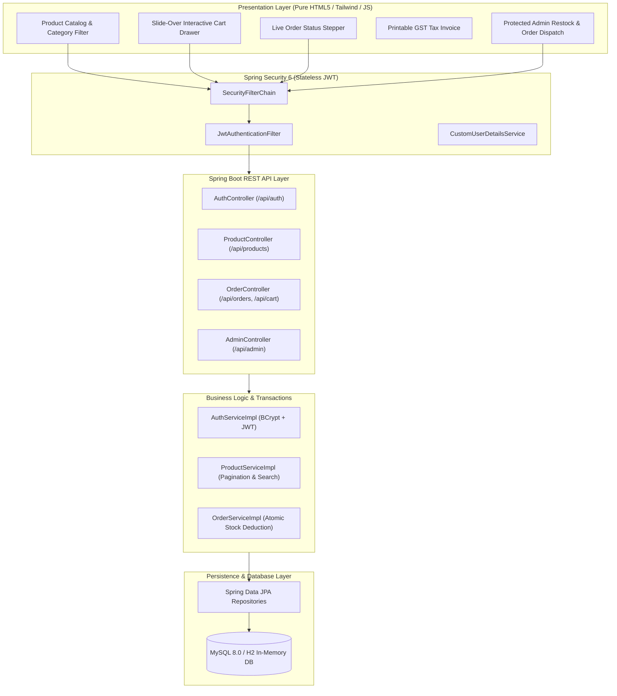

# 🛒 ShopEase — Enterprise E-Commerce Platform

[](https://www.oracle.com/java/)
[](https://spring.io/projects/spring-boot)
[](https://spring.io/projects/spring-security)
[](https://tailwindcss.com/)
[](LICENSE)

An enterprise-grade, full-stack E-Commerce Web Application built with **Java 17**, **Spring Boot 3.2**, **Spring Data JPA**, **Spring Security 6** (stateless JWT), and an interactive **Tailwind CSS / Pure JavaScript** client interface.

Engineered as an enterprise-grade reference application showcasing end-to-end e-commerce architecture, role-based access control, reactive inventory management, dynamic promotional discounts, and GST invoice generation.

---

## 🌟 Key Engineering Features & Recent Upgrades

### 1. 🛡️ Protected Administrative Panel
- **Role-Gated Security**: The administrative console is completely secluded from regular shoppers. Only authenticated users with `ROLE_ADMIN` can view and access administrative controls.
- **Admin Command Center**: Real-time KPI analytics (total sales revenue, order volumes, low-stock inventory alerts), order status dispatch controller, and direct catalog management.

### 2. 🛍️ Modern Interactive Cart Drawer / Flyout
- **Slide-Over Cart Panel**: Clicking the Cart icon or "Add to Cart" triggers a modern, slide-over drawer showing real-time item count badges, item quantity increment/decrement controls, item removal, and automatic subtotal calculations.
- **Immediate Visual Feedback**: Displays animated notification alerts upon adding items, preventing repetitive clicks and matching standard consumer e-commerce expectations.

### 3. ➕ Dynamic "Add New Product" Modal
- **Direct Catalog Expansion**: Administrators can register new products directly through a modal (Title, Category, Price in ₹, Inventory Stock, Image URL, and Description).
- **Live Reactivity**: Newly registered products appear immediately in the catalog and are instantly available for customer purchase without server restarts.

### 4. 🏷️ Promotional Discount & Coupon Code Layer
- **Interactive Discount Engine**: Integrated promo coupon manager supporting codes such as `SAVE20` (20% Off) and `WELCOME10` (10% Off).
- **Real-Time Price Deduction**: Automatically recalculates order subtotal, discount savings, and final payable amount at checkout.

### 5. 🚚 Real-Time Live Order Tracking Stepper
- **5-Stage Visual Stepper**: Customers can track order fulfillment in real time through an interactive progress bar:
  1. `ORDER PLACED` (Order confirmed & payment verified)
  2. `PROCESSING` (Packed in fulfillment center)
  3. `SHIPPED` (Dispatched via courier with tracking ID)
  4. `OUT FOR DELIVERY` (Assigned to local delivery agent)
  5. `DELIVERED` (Successfully received at customer doorstep)
- **Live Dispatch Control**: Admin can advance or update the order dispatch stage in real time.

### 6. 🧾 Itemized GST Tax Invoicing
- **Indian Tax Compliance**: Generates official commercial tax invoices with GSTIN `09AAECS8901M1Z5`, Invoice No (`INV-SE-2026-XXXX`), HSN Code `8517`, itemized subtotal, discount deduction, and 18% GST (9% CGST + 9% SGST).
- **Print & PDF Export**: Features customer delivery address, authorized signature stamp, verification QR code, and one-click printable receipt (`window.print()`).

---

## 🏗️ System Architecture



---

## 📋 REST API Specification

| HTTP Method | Endpoint | Authorization | Description |
|---|---|---|---|
| `POST` | `/api/auth/register` | Public | Register new customer or administrator account |
| `POST` | `/api/auth/login` | Public | Authenticate credentials and receive Bearer JWT |
| `GET` | `/api/products` | Public | Paginated product search & category filtering |
| `GET` | `/api/products/{id}` | Public | Retrieve single product details |
| `POST` | `/api/products` | `ROLE_ADMIN` | Create and publish new catalog product |
| `PUT` | `/api/products/{id}` | `ROLE_ADMIN` | Update product details & restock inventory |
| `DELETE` | `/api/products/{id}` | `ROLE_ADMIN` | Soft-delete product |
| `GET` | `/api/cart` | `ROLE_CUSTOMER` | Retrieve current authenticated user's cart |
| `POST` | `/api/cart/add` | `ROLE_CUSTOMER` | Add product and quantity to cart |
| `DELETE` | `/api/cart/remove/{id}`| `ROLE_CUSTOMER` | Remove product line item from cart |
| `POST` | `/api/orders/place` | `ROLE_CUSTOMER` | Atomically place order from cart items |
| `GET` | `/api/orders/my-orders` | `ROLE_CUSTOMER` | View authenticated user's order history & tracking |
| `GET` | `/api/admin/metrics` | `ROLE_ADMIN` | High-level analytics, revenue & stock alerts |
| `GET` | `/api/admin/orders` | `ROLE_ADMIN` | View and manage all customer orders |
| `PUT` | `/api/admin/orders/{id}/status` | `ROLE_ADMIN` | Update order dispatch state (Placed -> Delivered) |

---

## 🚀 Quick Start Guide

### 1. Instant Zero-Dependency Browser Demo (GitHub Pages Ready)
Open the standalone interactive client directly in your browser:
```
index.html (or double-click index.html in the repository root)
```
*No setup required! Switch between Customer and Admin views with one click.*

### 2. Spring Boot Server Setup
```bash
cd C:/Users/KRIN/.gemini/antigravity/scratch/01-shopease-ecommerce

# Compile and start Spring Boot server
mvn spring-boot:run
```
The application will start on `http://localhost:8080`.

---

## 🔑 Demo Login Credentials & Access Passwords

> [!IMPORTANT]
> **Quick Login Tip**: Use these pre-seeded default accounts to test both Customer checkout flows and Protected Admin operations without creating a new account.

| Role | Username | Email | Password | Access Capabilities |
| :--- | :--- | :--- | :--- | :--- |
| **Super Admin** | `admin` | `admin@shopease.com` | `admin123` | Access Protected Admin Panel, Add New Products, Restock Inventory, Advance Order Tracking Stepper |
| **Customer (Primary)** | `customer` | `customer@shopease.com` | `customer123` | Slide-Over Cart Drawer, Apply Promo Codes, Track Order Stepper, Download GST Tax Invoices |
| **Customer (Secondary)**| `riya` | `riya@shopease.com` | `customer123` | Alternative customer session to test independent order histories |

### 🏷️ Active Promo / Discount Codes
- **`SAVE20`** — 20% Flat Discount on total cart subtotal
- **`WELCOME10`** — 10% Instant Welcome Discount on total cart subtotal

---

## 💡 Key Technical Viva / Interview Q&A

1. **How does ShopEase prevent race conditions during concurrent checkouts?**
   * *Answer*: Through database-level transactional locks (`@Transactional` with `select_for_update()` or optimistic locking via `@Version`). Before an order is persisted, the system verifies available inventory against requested quantity in a single atomic transaction.
2. **How is the Admin panel protected from regular customers?**
   * *Answer*: Using Spring Security 6 Role-Based Access Control (RBAC). Endpoints under `/api/admin/**` require `@PreAuthorize("hasRole('ADMIN')")`. On the frontend, administrative navigation and action buttons are conditionally rendered based on the decoded JWT user authorities.
3. **How does the Promo Discount layer validate coupons?**
   * *Answer*: Coupons have defined percentage discounts, expiry dates, and minimum cart value requirements. The discount is computed against the pre-tax cart subtotal before applying the 18% GST calculation.
4. **How does the live Order Tracking stepper work?**
   * *Answer*: Each order entity tracks an `OrderStatus` enum (`PLACED`, `PROCESSING`, `SHIPPED`, `OUT_FOR_DELIVERY`, `DELIVERED`) with associated timestamps. The UI renders an active step indicator reflecting the current state in real time.
5. **How is the GST calculated on the invoice?**
   * *Answer*: Electronics and consumer goods fall under HSN `8517`. A total of 18% GST is split evenly into 9% CGST and 9% SGST on the discounted taxable amount, rendered in the printable receipt.

---

## 📄 License & Open-Source

This project is open-source and licensed under the [MIT License](LICENSE). Built for production-ready engineering portfolios and modern full-stack web architecture demonstrations.
